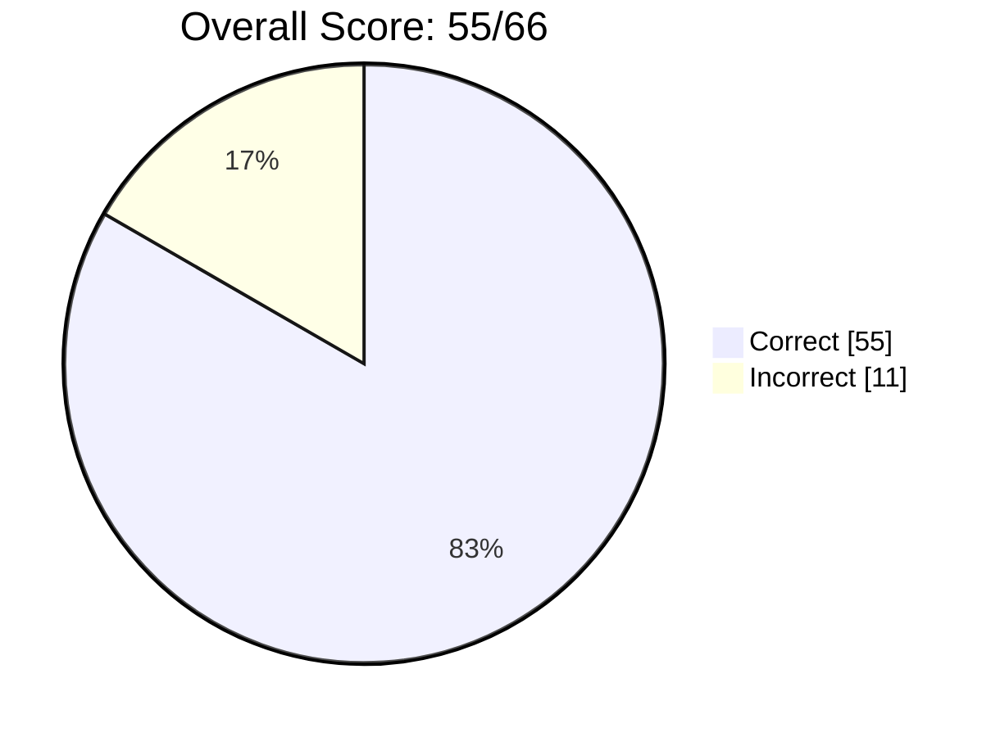
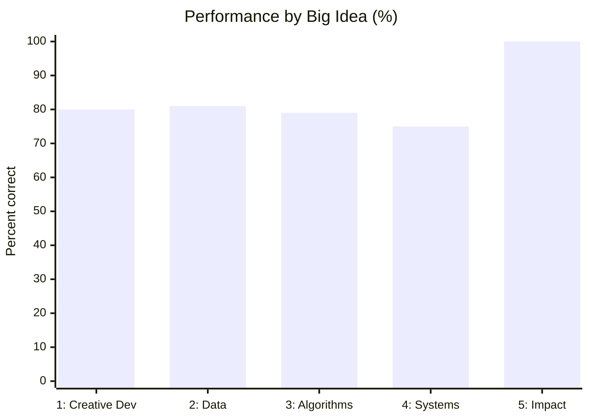
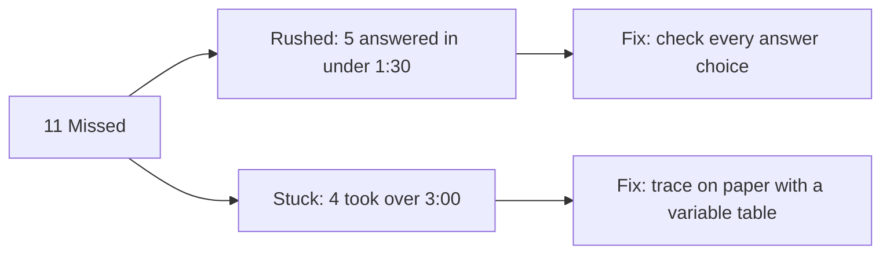
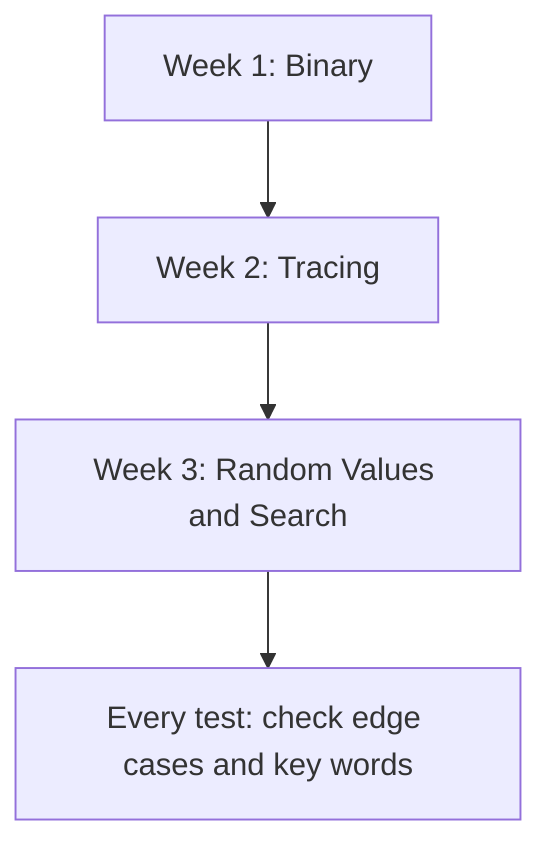

Author: Anika2317 | Exam: AP CSP 2018 Practice MCQ | Total time: 2:10:14

---

## Overall Score


| Score | Percent | Correct | Missed |
|:---:|:---:|:---:|:---:|
| 55 / 66 | 83% | 55 | 11 |



---

## The Story

- Going in: Prepared from recent Python work and logic practice.
- Went smoothly: Logic gates, flowcharts, compression, and ethics/impact questions.
- Found hard: Questions that needed step-by-step calculating or tracing.
- Pattern: Some misses were miscalculations, and others I got stuck on for over 3 minutes.
- Takeaway: My concepts are somewhat stronger. My weak spot is tracing.

---

## Glows and Grows

| Glows | Grows |
|:---|:---|
| Impact of Computing (100%): ethics, digital divide, safe computing | Binary limits: bit requirements and overflow |
| Data compression and Boolean logic (100%) | Tracing loops, coordinates, and edge cases |
| Evaluating solutions and iterative design | Search algorithms and unequal probabilities |

---

## Category Statistics

### The 5 Big Ideas

| Big Idea | Exam Weight | Questions | Performance |
|:---|:---:|:---:|:---:|
| Big Idea 1: Creative Development | 10–13% | 5 | 80% |
| Big Idea 2: Data | 17–22% | 16 | 81% |
| Big Idea 3: Algorithms and Programming | 30–35% | 34 | 79% |
| Big Idea 4: Computing Systems and Networks | 11–15% | 4 | 75% |
| Big Idea 5: Impact of Computing | 21–26% | 11 | 100% |



Big Idea 3: Algorithms and Programming is over half the exam (34 of 66), so improving there matters most.

### Computational Thinking Practices

| Practice | Questions | Performance |
|:---|:---:|:---:|
| P5: Investigate computing innovations | 19 | 89% |
| P1: Design and evaluate solutions | 17 | 88% |
| P2: Develop and implement algorithms | 11 | 82% |
| P3: Develop programs with abstractions | 9 | 78% |
| P4: Evaluate and test algorithms | 10 | 70% |

My lowest practice (P4) and lowest skill (4.B, determine the result of code segments, 67%) both point to tracing as my main gap.

### Topics to Review

| Topic | Performance |
|:---|:---:|
| 3.1 Variables and Assignments | 67% |
| 4.1 The Internet | 67% |
| 3.17 Algorithmic Efficiency | 50% |
| 3.15 Random Values | 50% |
| 2.1 Binary Numbers | 50% |
| 3.10 Lists | 0% (1 question) |

### Timing

Missed questions averaged 2:11, compared to 1:33 on correct ones.



---

## In-Depth Concept Analysis

### Metadata vs. Data
- KNOW: I can identify descriptive details like genre and author.
- Don't KNOW: Metadata is "data about data": tags used to sort and search (title, author, date, genre). The content itself, like the file or its old versions, is data, not metadata.

### Binary Numbers
- KNOW: Characters are stored as binary.
- Don't KNOW: n bits give 2^n values. Pick the smallest power of 2 that covers what's needed.

| Bits | Values | Max integer |
|:---:|:---:|:---:|
| 4 | 16 | 15 |
| 7 | 128 | 127 |
| 8 | 256 | 255 |

200 characters need 8 bits. With 4 bits, anything over 15 is an overflow error.

### Open Standards and Protocols
- KNOW: Open content licensing (Creative Commons).
- Don't KNOW: Open protocols (TCP/IP, HTTP) are public communication rules that let different manufacturers' devices work on the same network. They are not about sharing content.

### Swapping Values
- KNOW: A temp variable prevents losing a value.
- Don't KNOW: The swap needs all three steps:

```text
temp   ← first
first  ← second
second ← temp
```

### Coordinate Math in Loops
- KNOW: Basic grid movement and loop counts.
- Don't KNOW: Moving down and to the right means x increases and y decreases each loop.

### Unequal Probabilities
- KNOW: `RANDOM(a, b)` simulates chance.
- Don't KNOW: A 1:1:4 ratio is 6 parts, so use `RANDOM(1, 6)` and give the largest range (4 of 6) to the largest section.

### Boolean Comparisons
- KNOW: How to calculate `0.5 * total`.
- Don't KNOW: A majority means `counter > 0.5 * total` (the part is strictly greater than half).

### Algorithmic Efficiency
- KNOW: Loops process each list item.
- Don't KNOW: Total time = calls before the loop + calls inside the loop × items. One setup call plus 4 loop calls = 5.

### Linear vs. Binary Search

| | Linear | Binary |
|:---|:---|:---|
| How it works | Checks every item in order | Cuts the list in half each step |
| Needs sorted list? | No | Yes |

### Edge Cases and Infinite Loops
- KNOW: Repeating until a target is reached.
- Don't KNOW: If `count` starts at 0 and only goes up, `REPEAT UNTIL (count = y)` never ends when y is negative.

---

## Two Right / Two Wrong

| Got Right | Got Wrong |
|:---|:---|
| Boolean logic and data compression | Binary limits and overflow |
| Computing impacts and ethics | Step-by-step code tracing |

---

## Next Steps



- [ ] Memorize 2^1 through 2^8 and practice overflow problems.
- [ ] Trace every code-result question on paper with a variable table.
- [ ] Code a 1:1:4 spinner simulation in Python.
- [ ] Code linear and binary search and compare their steps.
- [ ] Re-check answers made in under 30 seconds. Skip and return after 3 minutes.

---

## Overall in Class

| What I'm Enjoying | What I Want to Improve |
|:---|:---|
| Independence to work on passion projects | Tracing code by hand |
| Collaborating with the group we created | Binary and data representation |
| Building the Poway Recovery Center website | Lists and search algorithms |
| Learning new skills through the lessons | Pacing on longer problems |

Overall, this class has been a really positive experience so far. I've especially enjoyed the independence to work on projects I care about, the collaboration within our group, and building the Poway Recovery Center website for a real organization. I'm learning new skills through the lessons and projects, and this reflection showed me exactly what to focus on next.

Goal: Get Algorithms and Programming and Practice 4 above 85% by tracing on paper and checking edge cases.