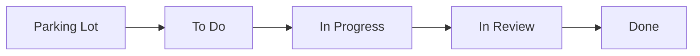
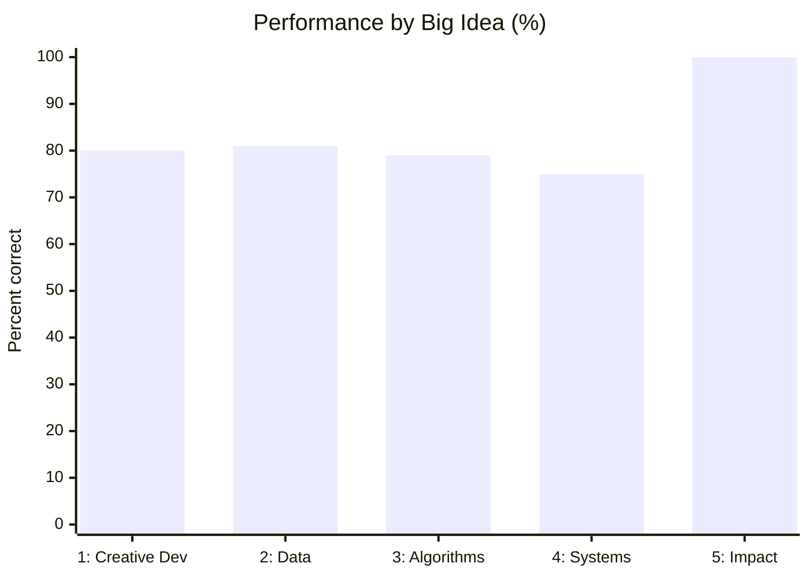

Author: Anika2317 | Team: Anika, Adya, and Jailene

---

## The Poway Recovery Center

This trimester, my team built a [website](https://prc.opencodingsociety.com) for the [Poway Recovery Center](https://pages.opencodingsociety.com/capstone/poway-recovery-center/), which supports people affected by dependency disorders. Someone using our site may be having a very hard week, so I learned that code for real people has to be correct, predictable, and gentle.

I worked on the home page, the resource hub, a program quiz, and the Recovery Tracker. Next, we need the center's feedback, since its community should guide what we keep.

---

## Working as a Team

The best part of this project was building it with Adya and Jailene. None of us could have made the whole site alone.

| Teammate | What they brought |
|:---|:---|
| Adya | Led us as Scrum Master and built most of the backend |
| Jailene | Designed our logo and organized our planning and diagrams |
| Me | Built the pages and tools people use directly |

One of Jailene's diagrams shows how an idea can move through a team project:

Our work also built on each other's. I wrote the first Reflection Wall, and Adya later connected it to the backend.

| What Went Well | What I Want to Improve |
|:---|:---|
| We each owned part of the project | Learning more of Adya's backend |
| We could work at the same time | Keeping our board up to date |
| We planned together in GitHub issues | Clearer commit messages for my team |

---

## Night at the Museum

At Night at the Museum, our team talked about our website, and I talked to Damon about what we built for the center.

<!-- ADD: what you showed Damon, what Damon said, and what you'd change because of it. -->

---

## Homework

Each homework had its own theme, which made the concepts easier for me to picture.

| Homework | What I did | What I took from it |
|:---|:---|:---|
| Variables | Modeled a game's settings and score | A Boolean fits a yes/no choice and can't be misspelled |
| Data Abstractions | Tracked stars across game levels | One list beats 100 separate variables |
| Strings | Pulled hidden words out of a transmission | Slicing is all about getting the index right |
| Booleans | Validated auto parts records | Check the data before trusting it |
| Conditionals | Built a scam message checker | "It runs" isn't the same as testing every branch |
| Iterations | Scanned wildfire alerts by zone | A loop can skip items or stop early |
| Developing Algorithms | Made a supply closet restock report | Turn the plan into steps before coding |
| Algorithmic Efficiency | Compared ways to find a library book | Binary search takes far fewer checks, but needs a sorted list |
| SASS and HTML | Practiced containers, grids, buttons, inputs, and toggles | These became the skills I used to style our site |

My buttons homework linked to mental health resources, and my inputs homework used a search bar for resources. Those felt close to the kind of work I was doing for the center.

My homework tended to bunch up right before it was due, so I want to spread it out more.

---

## What the MCQ Taught Me

I scored 55/66 (83%) on my [2018 practice MCQ](/csp/mcq-2018-reflection). My concepts are fairly solid, but tracing code step by step is my weak spot.

Doing well on homework didn't always carry over to the exam, so I want to keep practicing after each lesson. I haven't retaken a practice exam yet. My goal is to get Algorithms and Programming above 85% next time.

---

## Glows and Grows

| Glows | Grows |
|:---|:---|
| Building for a real organization | Tracing code without running it |
| Working with my team | Understanding our backend |
| Connecting homework to our project | Spreading out my work |

---

## Final Thoughts

A mistake on an exam costs me a point, but a mistake on this site could affect someone who needs help. That changed how I think about testing and wording. I'm proud of what Adya, Jailene, and I built together.
